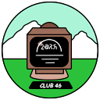

# Deep Dark Fantasies от деда Серёжи

> Думал что будет Vanilla+ версия, в итоге как обычно.

Сборка старается соблюдать баланс между теми, кому нравится
- Последовательно и неторопливо развиваться, строить всякие красивые постройки или механизмы. В общем кайфовать от размеренного геймплея...
- Дай дубину, я нашёл какой-то данж! Там куча врагов, я сдох уже 7 раз, но их осталось совсем чуть-чуть! На этот раз точно зачищу!

В общем, почти всё, что можно скрафтить упорным трудом, можно залутать в данже, но не менее упорным героизмом.
> Мультиплеер работает. Рекомендую хосту использовать выделенный сервер.

## Список модификаций и прочее

- [Моды](.minecraft/mods/MODLIST.md)
    - У некоторых модов есть приписка `ZaryaEdition` - это означает, что мод допиливался до потребностей сборки
- [Музыка](.minecraft/config/MusicTriggers/songs/MUSICLIST.md)
- [Ресурспаки](.minecraft/resourcepacks/RESOURCEPACKLIST.md)
- [Датапаки](.minecraft/global_packs/required_data/DATAPACKLIST.md)

## ЧтоКудаКого?
Рекомендуется поставить [PineconeMC](https://pineconemc.ru/download), так как сборка запускается/тестируется на нём.
Если вы используете другой лаунчер, или у вас не Windows, то разбирайтесь сами, инструкции ниже вам не помогут.

### 1. Установка [PineconeMC](https://pineconemc.ru) (на примере портативной версии)
1. Скачайте [Portable](https://pineconemc.ru/download) версию (`Windows` - `MSVC` - `x64` - `Portable`)
2. Распакуйте в любое удобное место (например в папку `PineconeMC`)
3. Заходим в папку `PineconeMC` и запускаем `elyprismlauncher.exe`
4. Делаем первоначальную настройку:
    1. Выбираем язык (русский). Нажимаем `Далее >`
    2. Можно выбрать тему и интерфейс, жмяк `Завершить`
5. Теперь настройка аккаунта (никнейма).
    1. Нажмите `Учётные записи` => `Управление учётными записями...`
    2. Если нет оффициального аккаунта (или Ely.by), то `Добавить автономную`
    3. Введите никнейм, английские буквы без спецсимволов и пробелов
    4. Нажмите `ОК`
    5. Закройте окно настроек
    6. Вверху справа вы увидите добавленный вами аккаунт.

### 2. Установка релиза сборки
1. Скачиваем [релиз](https://mega.nz/folder/cxt2TQYA#IjXcz29KzdS_Irkl7ay56A)
2. В PineconeMC нажимаем `Добавить экземпляр` => `Импорт` => `Обзор`
3. Выбираем путь до архива и нажимаем `OK`
4. Справа под иконкой сборки нажмите `Изменить...`. Откроется окно настроек сборки
5. Перейдите на вкладку `Параметры` => `Java`
6. В разделе `Память` указываем количество выделяемой оперативной памяти. **Не ставьте больше, чем у вас есть!**
    - `Минимальное использование памяти` где-то от *4096* до *6144* (4-6 Гигов)
    - `Максимальное использование памяти` от *6144* до сколько не жалко. Главное чтобы у вас хватило памяти
    - Почему так много требуется? Потому что too much mods
7. Можете закрыть окно настроек, всё готово
    - Java 17 лаунчер подберёт или скачает сам при первом запуске. Если не вышло, смотрите [Игра не запускается из-за Java](#игра-не-запускается-из-за-java)

### Установка обновлений сборки
> **Если у вас версия ниже `r1.41.0`**, рекомендуется [установить новый лаунчер](#1-установка-pineconemc-на-примере-портативной-версии) и [поставить релиз](#2-установка-релиза-сборки) заново.

Если у вас старая версия сборки, и вы хотите обновиться до нового, то чтобы не качать всю сборку заново, можно скачать и установить обновления, которые весят **гораздо меньше** всей сборки.
- Узнать текущий релиз можно по файлу `Changelog rA.B.C.lnk` рядом с папкой `.minecraft` или по названию сборки в окне PineconeMC.
Инструкция на примере, если у вас версия `r1.36.0`, а последняя версия `r1.37.0`.
1. Скачиваем [архив с обновлением](https://mega.nz/folder/41tWHSJQ#rvc9d_8c_dLBVYyKy3L40g) `r1.36.0 - r1.37.0.zip`
2. Запускаем PineconeMC
3. Выбираем сборку и нажимаем кнопку `Папка сборки`
4. Распаковываем сюда содержимое архива (папку `Update_r1.36.0_r1.37.0` и файл `Обновление с r1.36.0 до r1.37.0.bat`)
5. Запускаем `Обновление с r1.36.0 до r1.37.0.bat` в порядке возрастания версии
    - Если файл `Changelog r1.36.0.lnk` переименовался до нужной версии (`Changelog r1.37.0.lnk`), то значит всё прошло успешно (иначе появившаяся консоль должна написать причину ошибки).
6. Перезапускаем PineconeMC
7. ???
8. Profit
- Если у вас к примеру `r1.36.0`, а последняя `r1.42.0`. То сначала ставите обновление `r1.36.0 - r1.37.0.zip`, потом `r1.37.0 - r1.38.0.zip` и так далее.

## Пояснения по версионированию
Версия `rX.Y.Z`
- Мажорная `X` - переход на другую версию Minecraft
- Минорная `Y` - основные изменения (обновление/допиливание модов, датапаков)
- Патч `Z` - переводы, конфиги, ресурспаки, скрипты и прочее. Изменения, которые ещё позволяют играть по сети на тех же `X.Y` версиях с другими патчами.

# Помогите...

## Игра не запускается из-за Java
Обычно PineconeMC сам подбирает или скачивает нужную Java 17. Если при запуске ругается на Java, поставьте её вручную:
1. Справа под иконкой сборки нажмите `Изменить...`. Откроется окно настроек сборки
2. Перейдите на вкладку `Параметры` => `Java`
3. Поставьте галочку у раздела `Установка Java`
    1. Нажмите `Открыть загрузчик Java`. Откроется окно скачивания Java
    2. Нажмите `Adoptium` => `Java 17` => Выберите самую новую из списка, запомните её.
    3. Кнопка `Скачать`. Ждите. Вас вернёт в окно настроек
    4. Нажмите `Найти`. В появившемся окне выберите ранее скачанную версию, нажмите ОК
    5. Нажмите `Проверить настройки`. Если вылезет окно с `Проверка Java прошла успешно`, тогда всё получилось.

## Я создаю мир, а что дальше?
- В игре есть книга квестов ([`FTB Quests`](https://www.curseforge.com/minecraft/mc-mods/ftb-quests-forge)). Откройте инвентарь и вверху слева нажмите на значок книжки. Здесь старался расписать все глобальные изменения в механиках игры. Там объяснят, почему нельзя ломать дерево рукой, почему вместо булыжника выпадают камни, как драться и прочее.
- Если ты появился рядом с домом, где на крыше есть платформа для призыва какого-то визера, то не советую сейчас ставить 3-ю голову))) Так скажем, оставь это на десерт...

## Что по шейдерам?
Сборка не включает в себя шейдеры, т.к. это вкусовщина и дополнительный объём. Я играю со старыми [`ComplementaryShaders_v4.7.2.zip`](https://www.curseforge.com/minecraft/shaders/complementary-unbound/files/4570482)([зеркало Modrinth](https://modrinth.com/shader/complementary-unbound/version/v4.7.2)), так как на последних версиях не колышется кастомная трава и некорректно отображается свечение лежащего предмета. Если вам всё равно на это, или уже в каких-то новых версиях починили, то смело качайте версию [новее](https://www.complementary.dev/shaders/). Каких-то конкретных требований к шейдерам у сборки не обнаружено.
- Опять же это всё вкусовщина, не нравится как выглядит, ищите другие :-)

## Если лагает...
Смиритесь... поиграйтесь с настройками графики сами, попробуйте:
- Отключить динамическое освещение (`Настройки...` => `Настройки графики` => `Dynamic Lights` => `Dynamic Lights Speed`)
- Уменьшить уровень детализации (`Настройки...` => `Настройки графики` => `Качество` => `Уровни детализации`)
- Чуть уменьшите прорисовку, только не до состояния как ёжик в тумане (`Настройки...` => `Настройки графики` => `Основное` => `Прорисовка`)
- Чуть уменьшите симуляцию (`Настройки...` => `Настройки графики` => `Основное` => `Симуляция`)
- Отключить [`Physics Mod`](https://www.curseforge.com/minecraft/mc-mods/physics-mod) — самый тяжёлый по FPS мод в сборке. Мод клиентский, на сервере его нет, поэтому играть по сети без него можно. Пропадут только красивости: рэгдоллы мобов, физика дыма, воды, снега, тканей и лиан (физика выпавших предметов останется от `ItemPhysic`).
    1. Закройте игру
    2. Справа под иконкой сборки нажмите `Изменить...` => вкладка `Моды`
    3. Найдите `Physics Mod` и снимите у него галочку (или выделите и нажмите `Отключить`)
    4. Вернуть мод можно так же, поставив галочку обратно
- **(ОЧЕНЬ АККУРАТНО С ЭТОЙ ОПЦИЕЙ)** Попробуйте уменьшить разрешение игры (`Настройки...` => Зажать `SHIFT` и английскую клавишу `P` => Пока зажаты клавиши, нажать на `Настройки графики` => Отрегулируйте `Полноэкранное разрешение`). Тут только методом тыка выбирать комфортное ~~мыло~~, другие настройки на этой форме редактировать не советую.
    - Возможен баг, что если у вас полноэкранное разрешение стоит не `Текущее`, то при переключении на другое окно (например через `Alt`+`Tab`) сборка может намертво повиснуть (привет из Skyrim'а). Поможет только завершение работы Майна. Чтобы избежать такого поведения, то сначала надо выйти из полноэкранного режима (`F11`), а затем что-то делать в других окнах.